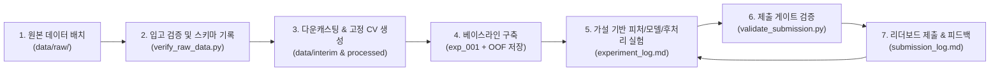

# 하네스 엔지니어링 (Harness Engineering) 아키텍처 가이드

이 문서는 본 프로젝트가 왜 아래와 같은 폴더 계층과 검증 루프로 설계되었는지, 그리고 사용자와 AI 에이전트가 어떻게 협업하여 안정적으로 성능을 끌어올리는지 설명합니다.

---

## 1. 설계 철학

머신러닝 경진대회에서 가장 흔한 실패 원인은 **(1) 데이터 누수(Data Leakage)**, **(2) 일관성 없는 CV 분할로 인한 앙상블 불가**, **(3) 실험 이력 유실**, **(4) 제출 파일 포맷 실수로 인한 일일 제출 기회(5회) 낭비**입니다.

본 프로젝트의 하네스는 이를 구조적으로 차단하기 위해 4가지 기둥으로 구성됩니다:

1. **컨텍스트 계층화 (Progressive Context)**:
   - 루트 [AGENTS.md](../AGENTS.md)는 항상 로드되어 핵심 제약사항과 지도(Map) 역할을 수행합니다.
   - 세부 도메인 지식은 `docs/`에, 작업 절차는 `.agents/skills/`에 분리하여 컨텍스트 오염 없이 정확한 지침을 제공합니다.
2. **데이터 불변 파이프라인 (`raw` → `interim` → `processed`)**:
   - 원본 훼손을 원천 차단하고, 대용량(8개 도메인 × 6개월 Parquet) 병합 비용을 `interim` 캐시로 최소화합니다.
3. **단일 진실 공급원 (Single Source of Truth Logs)**:
   - 모든 실험은 [experiment_log.md](../experiments/experiment_log.md)에, 모든 제출은 [submission_log.md](../submissions/submission_log.md)에 기록되며, 모든 모델은 동일한 Fold 인덱스의 OOF 확률을 `experiments/oof/`에 남깁니다.
4. **기계적 검증 게이트 (Automated Gates)**:
   - 데이터 입고 직후 `scripts/verify_raw_data.py`, 제출 직전 `scripts/validate_submission.py`를 통해 사람이나 에이전트의 실수를 코드로 검증합니다.

---

## 2. 전체 폴더 계층 구조

```text
신용카드 고객 세그먼트 분류/
├── AGENTS.md                        # [상시 적용] 에이전트 핵심 규칙 및 저장소 맵
├── README.md                        # 프로젝트 소개 및 빠른 시작 가이드
├── .gitignore                       # 데이터/모델 가중치/가상환경 Git 제외 규칙
├── requirements.txt                 # 재현 가능한 Python 의존성 목록
│
├── .agents/                         # 에이전트 전용 워크플로우 스킬 (On-Demand Runbooks)
│   └── skills/
│       ├── inspect-data/SKILL.md        # 원본 데이터 입고 검증 및 스키마 문서화 절차
│       ├── run-experiment/SKILL.md      # 가설 -> CV 학습 -> OOF 저장 -> 실험 기록 절차
│       └── validate-submission/SKILL.md # 제출 파일 무결성 7단계 검증 절차
│
├── configs/
│   └── paths.yaml                   # 경로(raw/interim/processed/oof/sub) 및 SEED 중앙 관리
│
├── docs/                            # 프로젝트 지식 베이스
│   ├── competition_overview.md      # 데이콘 236460 대회 개요, 평가, 규칙 상세 정리
│   ├── harness_architecture.md      # 현재 문서 (하네스 구조 및 운영 표준)
│   ├── data_schema.md               # 실제 데이터 스키마, 도메인별 키, 결측/분포 요약
│   └── feature_catalog.md           # 파생변수 정의 및 CV 성능 변화 추적표
│
├── data/                            # 데이터 레이어 (Git 미추적)
│   ├── raw/                         # [READ-ONLY] 데이콘 다운로드 원본 파일 배치 경로
│   ├── interim/                     # 타입 최적화(Downcast) 및 병합된 중간 Parquet
│   └── processed/                   # 고정 Fold 인덱스 및 모델 입력용 피처 데이터셋
│
├── notebooks/                       # EDA 및 시각화 노트북
│
├── src/                             # 모듈형 파이프라인 코드
│   ├── utils/                       # 시드 고정, 메모리 최적화, 설정/로거 유틸리티
│   ├── data/                        # Parquet 도메인 로더, 병합기, StratifiedGroupKFold 생성기
│   ├── features/                    # 고객별 6개월 시계열 집계(mean/std/last/trend) 및 도메인 파생변수
│   ├── models/                      # LightGBM, CatBoost, XGBoost, Neural Net 학습/추론 모듈
│   └── evaluation/                  # Macro F1 평가기, 클래스별 F1 분석, Threshold 최적화기
│
├── scripts/                         # CLI 실행 및 검증 게이트 스크립트
│   ├── verify_raw_data.py           # data/raw 입고 상태 및 파일 구조 자동 스캔
│   └── validate_submission.py       # 제출 CSV 무결성(UTF-8, ID, 행수, 클래스 분포) 검증
│
├── experiments/                     # 실험 아티팩트 및 로그
│   ├── experiment_log.md            # 실험 번호, 가설, CV Macro F1(클래스별 포함), 결과 기록
│   ├── oof/                         # 앙상블/후처리용 Out-Of-Fold 예측 확률 저장소
│   └── artifacts/                   # 모델 체크포인트, 피처 중요도 CSV/시각화
│
├── submissions/                     # 데이콘 제출 CSV 보관소
│   └── submission_log.md            # 제출 이력(일 5회 한도 관리) 및 CV vs Public LB 비교표
│
└── tests/                           # 파이프라인 무결성 및 누수 방지 단위 테스트
```

---

## 3. 표준 작업 흐름 (Standard Workflow)



### 단계별 핵심 체크포인트
1. **데이터 입고 시**: 다운로드한 압축 파일을 `data/raw/` 아래에 풀고 `python scripts/verify_raw_data.py`를 실행합니다.
2. **베이스라인 구축 시 (`exp_001`)**: 파생변수 없이 기본 병합 + 고정 5-Fold CV + LightGBM 기본 설정으로 **신뢰할 수 있는 기준점(Anchor CV)**을 먼저 확보합니다.
3. **피처/모델 반복 실험 시**: 한 번에 하나의 핵심 변경만 테스트하여 CV 증감 원인을 명확히 분리하고, 유의미한 변경만 메인 파이프라인과 [feature_catalog.md](./feature_catalog.md)에 반영합니다.
4. **앙상블 및 후처리 시**: 서로 다른 모델 패밀리(LightGBM + CatBoost + XGBoost + MLP 등)의 `experiments/oof/` 확률을 결합한 뒤, Out-Of-Fold 기준으로 Macro F1 최적화 임계값을 검증합니다.
